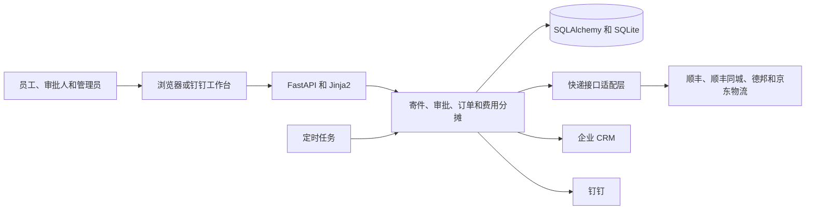

# 企业快递管理系统

企业快递管理系统用于统一处理员工寄件、内部审批、物流跟踪和月度费用分摊。系统把不同快递公司的接口整合到同一个下单流程中，并按照员工所在地区加载对应的快递产品、企业寄件地址和结算配置。

本仓库是可公开分享的演示版本。源码保留了完整的业务结构，人员、订单、地址、项目、部门和费用数据均为虚构内容。仓库中不包含企业密钥、月结账号、店铺编号、内部接口地址或生产数据库。

## 系统演示

在线演示运行的就是本仓库中的完整系统，不是另外制作的展示页面。访客可以进入现有的寄件页、审批中心、订单记录和管理后台，并使用脱敏演示数据体验页面交互。

演示环境强制关闭真实下单和外部企业接口。页面中的人员、电话、地址、部门、项目、订单和运单均为虚构内容。

任何人都可以通过公开演示地址进入，不需要登录企业钉钉，也不依赖项目所有者的电脑。演示环境允许填写寄件信息、查询模拟报价、提交审批和查看系统各个页面；正式下单会生成演示运单，不会请求快递公司的生产接口。


顺丰同城入口和下单页面也包含在公开演示中。厦门与北京使用各自的演示店铺资料，报价和运单均由安全演示模式生成。


在线地址会在仓库上传并完成演示服务部署后补充到这里。在此之前，可以按照下方步骤在本机运行相同的演示环境。

## 主要功能

### 寄件与审批

- 支持单票寄件和批量寄件。
- 支持部门费用和项目费用两种归属方式。
- 支持一级审批、二级审批、驳回和审批记录查询。
- 批量寄件在审批前按批次展示，正式下单后按运单展示。
- 报价、预计送达时间和下单失败原因会统一显示在页面中。

### 快递服务

- 接入顺丰、顺丰同城、德邦和京东物流。
- 统一处理报价、下单、取消、物流轨迹和实际费用。
- 每个地区可以单独设置可用产品和默认推荐产品。
- 不同地区的店铺、月结账号和接口配置相互隔离。

### 订单与物流

- 员工只能查看自己的寄件记录。
- 审批人可以查看需要本人处理的申请。
- 管理员可以查询全部订单并查看完整物流轨迹。
- 系统统一展示待审核、待揽收、已揽收、在途、派送中、已签收、客户拒收、异常和取消等状态。

### 项目和部门

- 从企业 CRM 同步项目名称、项目编码、执行部门和部门编码。
- 部门以完整组织路径展示。
- 项目费用分摊时，执行部门以 CRM 中的项目资料为准。
- 支持定时同步和管理员手动刷新。

### 月度费用分摊

- 管理员可以按月份、地区和快递公司上传费用账单。
- 系统按照运单号匹配下单记录和运单补充记录。
- 未匹配的账单行可以由管理员人工指定费用归属。
- 处理结果会保存，重新进入同一账单时可以继续编辑。
- 可导出部门分摊表、项目分摊表和分摊明细表。
- 可通过可视化页面查看费用趋势、地区分布和快递公司占比。

## 本地体验

本项目没有提供公开在线演示地址。页面需要由本机的 FastAPI 服务提供，因此浏览器地址只有在程序启动后才能访问。

### Windows 一键启动

1. 下载并完整解压项目。
2. 双击 `START-DEMO-WINDOWS.cmd`。
3. 首次启动会自动创建 Python 虚拟环境并安装依赖。
4. 初始化完成后，浏览器会自动打开系统首页。
5. 启动窗口必须保持运行。关闭窗口后，本地访问地址也会停止工作。

本地访问地址：

```text
http://127.0.0.1:26666/
```

如果页面无法打开，请先确认启动窗口中已经出现服务启动信息，并检查 `26666` 端口是否被其他程序占用。

### 命令行启动

```powershell
python -m venv .venv
.\.venv\Scripts\Activate.ps1
python -m pip install -r requirements.txt
Copy-Item .env.example .env
python scripts\create_demo_data.py
python run.py
```

启动后访问 `http://127.0.0.1:26666/`。

## 演示数据

演示环境会自动创建一个管理员账号和三个地区的示例员工，并生成不同快递公司、不同物流状态和不同费用归属方式的订单。

这些记录由 `scripts/create_demo_data.py` 生成。脚本不会读取生产数据库，也不会复制真实订单后进行简单打码。所有身份、电话、地址、公司、部门、项目、订单号和运单号都是独立构造的虚构内容。

需要恢复初始演示数据时执行：

```powershell
python scripts\create_demo_data.py --reset
```

## 技术架构

系统采用服务端渲染的 Web 架构。



更详细的模块关系和业务流程见 [系统架构说明](docs/ARCHITECTURE.md)。

## 项目结构

| 目录 | 说明 |
| --- | --- |
| `api` | FastAPI 应用、页面路由、接口和身份校验 |
| `config` | 环境变量和运行配置 |
| `courier` | 各快递公司的接口适配器 |
| `crm` | CRM 项目与部门同步 |
| `database` | 数据模型、数据库连接和结构升级 |
| `dingtalk` | 钉钉免登、组织信息和消息能力 |
| `scheduler` | 定时同步、物流刷新和提醒任务 |
| `utils` | 审批、状态转换、费用分摊和文件导出 |
| `web` | 页面模板、样式和前端脚本 |
| `resources` | 费用分摊空白模板 |
| `scripts` | 数据库初始化和演示数据生成 |
| `tests` | 自动化测试 |
| `docs` | 功能、架构、部署和隐私说明 |

## 配置说明

公开演示所需配置已经写在 `.env.example` 中。复制文件为 `.env` 后即可使用。

真实接口凭证只能保存在本机或服务器的 `.env` 文件中。不要把 `.env`、数据库、账单文件、日志或后台导出的区域配置提交到 Git。

公开演示默认开启安全预览模式，并关闭所有真实下单开关。即使误填了接口信息，程序也不会自动启用真实下单。

正式部署前请阅读 [部署说明](docs/DEPLOYMENT.md)。

## 隐私和安全

公开版本已经移除以下内容：

- 真实员工与客户信息
- 真实订单、运单和物流记录
- 企业部门、项目和费用数据
- 快递公司的密钥、客户编码和月结账号
- 顺丰同城店铺编号与回调令牌
- CRM 和钉钉凭证
- 内部域名、服务器地址和本机路径
- 生产数据库、备份、日志和导出文件

仓库提供 `tools/check_public_repo.py`，用于检查常见密钥文件、数据库、私钥、内网地址和本机绝对路径。GitHub Actions 会在每次推送时执行该检查和自动化测试。

完整处理范围见 [隐私处理说明](docs/PRIVACY.md)。安全问题和生产部署注意事项见 [安全说明](SECURITY.md)。

## 测试

```powershell
python -m pip install -r requirements-dev.txt
python -m pytest -q
```

当前公开版本已经通过 312 项自动化测试和 34 项子测试。

## 相关文档

- [功能清单](docs/FEATURES.md)
- [系统架构说明](docs/ARCHITECTURE.md)
- [部署说明](docs/DEPLOYMENT.md)
- [隐私处理说明](docs/PRIVACY.md)
- [安全说明](SECURITY.md)

## 使用许可

本仓库用于产品展示、技术交流和源码审阅。当前未采用开源许可证，未经项目所有者书面许可，不得将本项目用于商业部署、再分发或二次销售。
