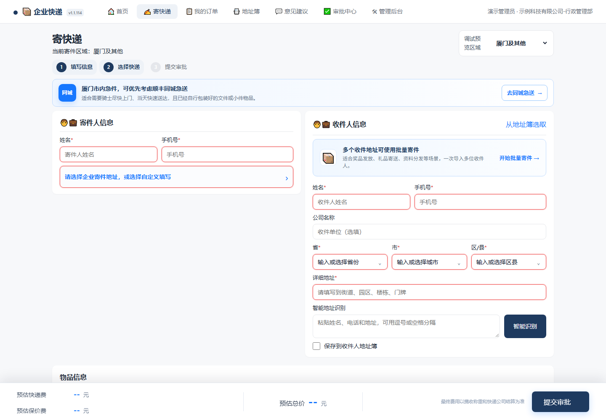
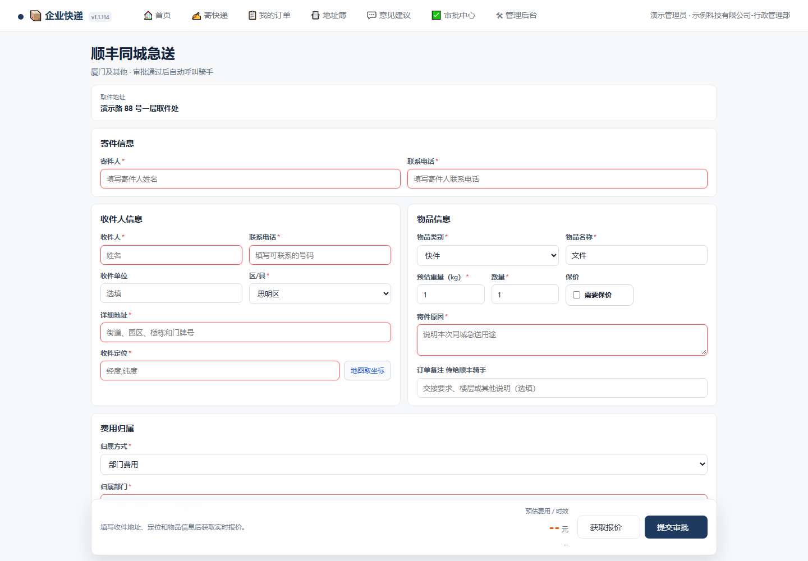
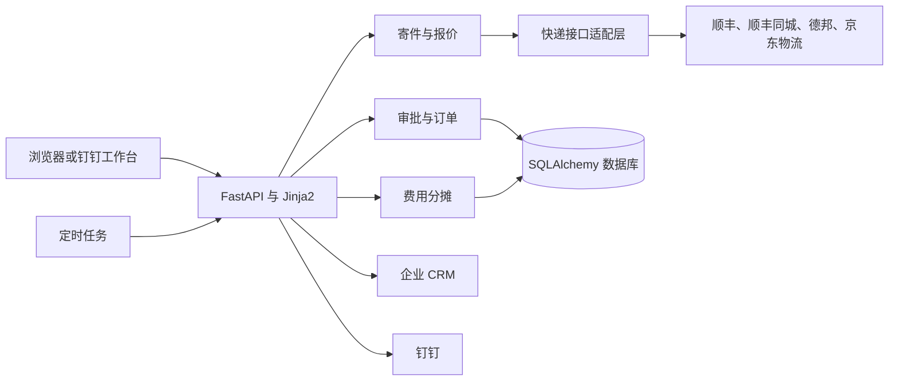

# 企业快递管理系统

一套面向企业内部寄件场景的全流程管理系统。它将员工寄件、费用归属、分级审批、快递下单、物流跟踪和月度费用分摊连接在同一套工作流中，让跨地区、跨快递公司的寄件业务可以统一执行、统一查询和统一结算。

<p align="center">
  <a href="https://enterprise-courier-demo.onrender.com/">
    
  </a>
  <a href="docs/ARCHITECTURE.md">
    
  </a>
</p>

> **无需安装或登录，直接体验完整系统：** [立即进入在线演示 →](https://enterprise-courier-demo.onrender.com/)
>
> Render 免费实例在长时间无人访问后会休眠，首次打开可能需要等待约 50 秒。



## 系统解决什么问题

企业寄件通常分散在不同快递平台、聊天记录和线下表格中。员工不知道该选哪种产品，审批人看不到完整费用，管理员难以核对月结账单，财务还需要手工判断每一票应由哪个项目或部门承担。

本系统把这些环节串成一条可追踪的业务链：


系统按地区加载可用的快递产品、企业寄件地址和结算配置。员工只需要在一个页面完成寄件，审批人可以看到完整申请信息，管理员则可以统一管理订单、组织资料、接口配置和费用分摊。

## 核心能力

### 统一寄件入口

- 支持单票寄件和批量寄件，适用于日常文件、物品寄送以及奖品集中发放等场景。
- 根据员工所在地区展示可用的顺丰、顺丰同城、德邦和京东物流产品。
- 每个地区可独立设置默认推荐产品，员工也可以自行切换其他服务。
- 在提交前展示预估费用和预计送达时间，减少员工在多个快递平台之间反复比较。
- 支持地址簿、批量导入、保价、物品信息和上门时间等常用寄件能力。

### 费用归属与组织资料

- 寄件时可以选择部门费用或项目费用。
- 部门和项目统一从企业 CRM 同步，并以完整组织路径展示。
- 项目记录同时保留项目编码、执行部门和部门编码。
- 项目费用进入月度分摊时，系统依据 CRM 中的项目执行部门生成归属，避免使用错误或过期的部门信息。
- 支持每日定时同步，也保留管理员手动刷新入口。

### 分级审批

- 支持一级审批、二级审批、驳回、跳过指定审批级别和完整审批记录。
- 审批记录与人员身份关联，同一员工在手机和电脑端看到一致的待办与历史。
- 批量寄件在正式下单前按一个批次审批，审批通过后再拆分为独立运单。
- 审批人可以查看整批总金额、每票金额、收件信息、费用归属和预计时效。
- 正式下单失败时直接展示承运商返回的具体原因，方便管理员处理。

### 快递下单与物流跟踪

- 通过统一适配层处理不同快递公司的报价、下单、取消、物流轨迹和实际费用。
- 各地区的店铺、月结账号和接口配置相互隔离，避免跨区域串用。
- 统一展示待审核、审核未通过、待揽收、已揽收、在途、派送中、已签收、客户拒收、异常和已取消等状态。
- 员工查看自己的寄件记录，审批人查看本人待办，管理员查看全公司的订单和物流明细。
- 支持系统外运单补充记录，让线下或其他渠道寄出的快递也能进入费用分摊流程。

### 月度费用分摊

- 管理员按月份、地区和快递公司上传承运商费用账单。
- 系统先按运单号匹配系统订单，再匹配员工提交的运单补充记录。
- 部门费用使用下单时选择的部门，项目费用使用下单时选择的项目及 CRM 中对应的执行部门。
- 未匹配记录会醒目标记，管理员可以搜索并人工指定项目或部门。
- 上传结果和人工调整会持续保存，其他管理员进入相同月份和快递时可以继续处理。
- 每月每个地区、每家快递可导出项目分摊表、部门分摊表和分摊明细表。
- 可视化页面支持按月份范围、地区和快递公司查看费用趋势、费用结构和分布情况。

## 在线交互演示

### [🚀 点击这里进入企业快递系统](https://enterprise-courier-demo.onrender.com/)

在线演示运行的是本仓库中的真实应用页面，可以直接浏览和操作：

- 首页与地区视角
- 单票寄件和批量寄件
- 顺丰同城急送
- 我的订单和物流详情
- 审批中心
- 管理后台
- 费用归属与月度分摊
- 运单补充记录

演示中预置了三个地区、多个角色以及不同快递公司和物流状态的数据，方便完整查看系统的页面结构和业务衔接。



公开演示使用独立构造的示例数据。报价、运单和物流变化由演示模式生成，不会产生真实寄件，也不会使用企业账号或生产密钥。这项说明仅用于明确公开体验环境的边界，不影响系统源码中展示的完整业务结构。

## 使用角色

| 角色 | 主要操作 |
| --- | --- |
| 员工 | 寄快递、批量寄件、选择费用归属、查看自己的订单、维护系统外运单记录 |
| 审批人 | 处理本人待审批申请、查看费用和时效、驳回或通过申请、查询审批历史 |
| 管理员 | 查看全部订单、维护区域与快递配置、管理组织资料、处理费用账单和导出分摊结果 |

## 技术架构

系统采用 FastAPI 服务端应用架构，通过 Jinja2 渲染页面，使用 SQLAlchemy 管理业务数据，并通过独立适配层连接快递、CRM 和钉钉能力。



更详细的模块关系和数据流见 [系统架构说明](docs/ARCHITECTURE.md)。

## 项目结构

| 目录 | 说明 |
| --- | --- |
| `api` | FastAPI 应用、页面路由、接口和身份校验 |
| `config` | 环境变量和运行配置 |
| `courier` | 各快递公司的统一接口适配器 |
| `crm` | CRM 项目、部门及组织路径同步 |
| `database` | 数据模型、数据库连接和结构升级 |
| `dingtalk` | 钉钉免登、人员信息和消息能力 |
| `scheduler` | 组织同步、物流刷新和月度提醒任务 |
| `utils` | 审批、状态转换、费用匹配和文件导出 |
| `web` | 页面模板、样式和前端交互脚本 |
| `resources` | 费用分摊模板 |
| `scripts` | 启动、初始化和演示数据生成脚本 |
| `tests` | 自动化测试 |
| `docs` | 功能、架构、部署和公开版本说明 |

## 本地运行

### Windows 一键启动

1. 下载并完整解压项目。
2. 双击 `START-DEMO-WINDOWS.cmd`。
3. 首次启动时等待程序创建运行环境并安装依赖。
4. 浏览器自动打开后即可体验系统。

本地访问地址为 `http://127.0.0.1:26666/`。启动窗口需要保持运行。

### 命令行启动

```powershell
python -m venv .venv
.\.venv\Scripts\Activate.ps1
python -m pip install -r requirements.txt
Copy-Item .env.example .env
python scripts\create_demo_data.py
python run.py
```

需要恢复初始演示数据时执行：

```powershell
python scripts\create_demo_data.py --reset
```

## 部署与配置

仓库包含 `render.yaml`，可以直接部署为 Render Web Service。其他服务器可参考 [部署说明](docs/DEPLOYMENT.md)。

公开演示所需的配置示例位于 `.env.example`。生产环境的密钥、月结账号、数据库和账单文件必须通过服务器环境变量或受保护的存储提供，不应提交到 Git 仓库。

## 质量与测试

```powershell
python -m pip install -r requirements-dev.txt
python -m pytest -q
```

当前公开版本通过 312 项自动化测试和 34 项子测试。GitHub Actions 会在每次推送时运行敏感信息检查和自动化测试。

## 相关文档

- [功能清单](docs/FEATURES.md)
- [系统架构说明](docs/ARCHITECTURE.md)
- [部署说明](docs/DEPLOYMENT.md)
- [公开版本与数据处理说明](docs/PRIVACY.md)
- [安全与生产部署说明](SECURITY.md)

## 使用许可

本仓库用于产品展示、技术交流和源码审阅。当前未采用开源许可证，未经项目所有者书面许可，不得将本项目用于商业部署、再分发或二次销售。
