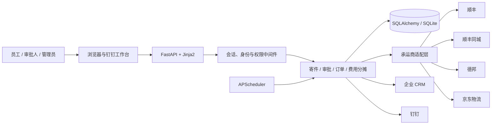
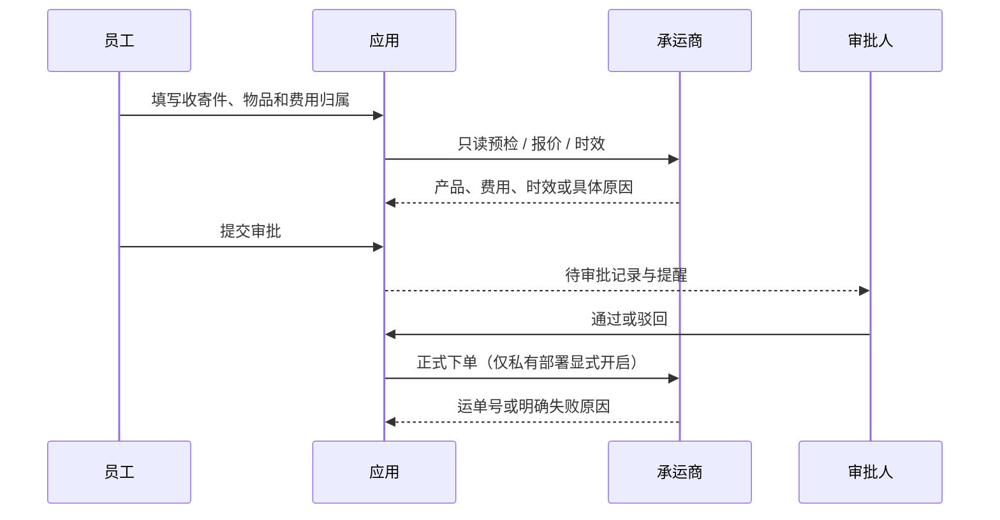

# 系统架构

## 总体结构

## 分层职责

1. **页面与接口层**：`api/main.py` 和 `api/routes/` 负责页面、JSON API、参数校验和权限边界。
2. **身份层**：会话中间件读取钉钉免登身份；公开演示用 `LOCAL_USER_ID` 加载虚构用户。
3. **业务层**：`utils/` 处理审批规则、统一状态、费用归属、账单匹配和导出。
4. **承运商层**：`courier/` 将不同厂商的签名、字段、错误码和状态转换为统一接口。
5. **数据层**：`database/models.py` 定义用户、地址、订单、批次、轨迹、项目、部门、账单和补充运单。
6. **计划任务**：`scheduler/` 负责 CRM/员工变化同步、物流刷新、审批提醒与月度提醒。

## 关键数据流

### 寄件与审批

### 月度费用分摊

1. 管理员选择月份、地区和快递，上传承运商账单。
2. 系统按运单号先匹配系统订单，再匹配运单补充记录。
3. 部门费用使用下单部门；项目费用使用项目，并从 CRM 项目资料取得执行部门。
4. 未匹配行保留原账单字段并提示人工指定。
5. 保存后，同一月份/地区/快递再次进入仍能看到当前处理状态。
6. 导出项目分摊、部门分摊和只含账单明细子表的分摊明细。

## 地区隔离

`region_code` 贯穿用户、企业地址、订单、批次、账单、补充运单和区域配置。承运商启用范围、默认推荐、店铺/月结配置均按地区读取，避免不同区域共用结算账号。
